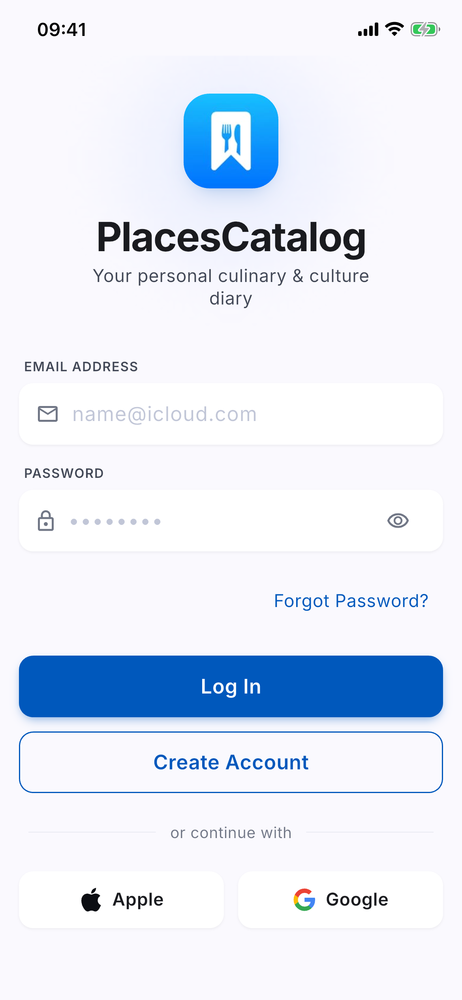
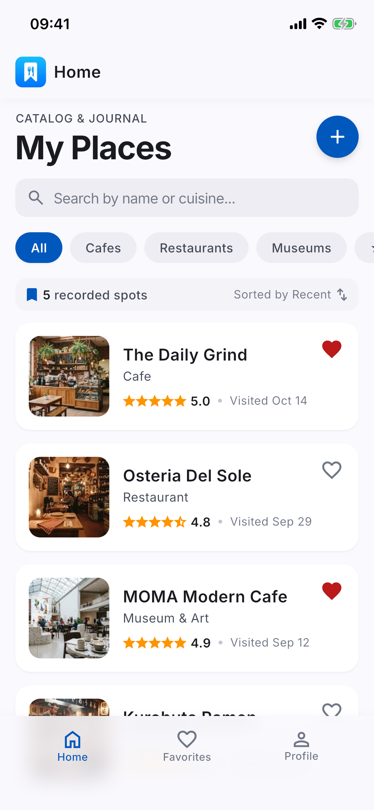
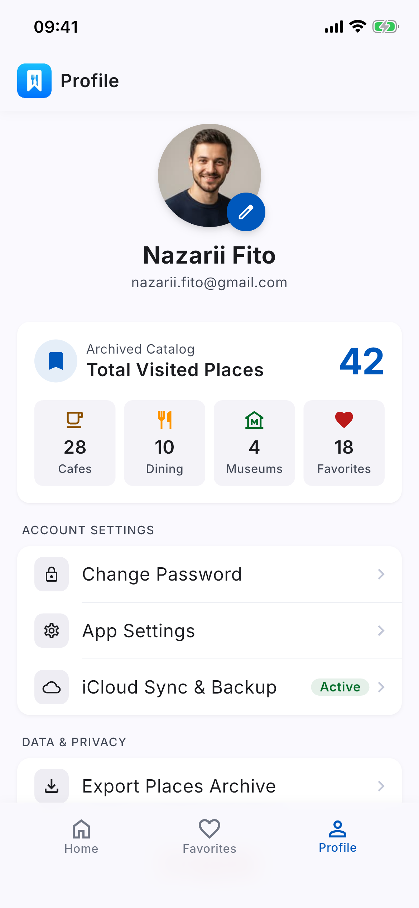

# PlacesCatalog

*Your personal culinary & culture diary* — мобільний застосунок для збереження відвіданих закладів (кафе, ресторани, музеї тощо) з оцінками, нотатками, тегами й фото.

Лабораторна робота №3 з дисципліни «Кросплатформне програмування» (НУ «Львівська політехніка», гр. ПЗ-33, Фітьо Назарій): базова структура застосунку та pixel-perfect верстка основних екранів за дизайном із ЛР №2, **без бізнес-логіки** (hardcoded / mock-дані).

## Стек

- Flutter 3.47 (stable), Dart 3.13, null safety, Material 3 + Cupertino-віджети.
- Цільова платформа — iOS 14+ (дизайн за Apple HIG); Android підтримується архітектурою.
- Залежності: `cupertino_icons`, `flutter_svg` (лише для відображення SVG-іконок, експортованих із Figma).
- Без state-management бібліотек, Firebase і мережевих пакетів: стан через `StatefulWidget` + `setState`, навігація через `Navigator` з іменованими маршрутами та `CupertinoPageRoute`.
- Шрифт Inter 4.1 (OFL) вбудовано в `assets/fonts/`.

## Екрани

| Етап 1 | Етап 2 |
|---|---|
| Login, Create Account, Forgot Password (зі станом «Check your email») | Favorites |
| Home (пошук, фільтри, список закладів) | Place Details + підтвердження видалення |
| Profile (статистика, налаштування, вихід) | Add Place |
| Change Password | Location Picker |

Навігація між вкладками — нижній Tab Bar (Home / Favorites / Profile).

## Запуск

```sh
flutter pub get
flutter run                  # стартує з екрана входу
flutter analyze              # 0 issues
flutter test                 # widget-тести, перевірка overflow
```

Щоб відкрити одразу потрібний екран (для скриншотів), задайте стартовий маршрут і вкладку:

```sh
flutter run --dart-define=INITIAL_ROUTE=/home --dart-define=INITIAL_TAB=2
```

## Структура

```
lib/
├── app/        # MaterialApp, маршрути (app_routes.dart)
├── core/       # дизайн-система: theme (токени з Figma), constants, widgets
├── data/       # незмінні моделі та mock-дані
└── features/   # екрани за фічами: auth, home, favorites, places, profile, shell
```

Повне дерево — `docs/report/structure.txt`.

## Документація

- `docs/decisions.md` — розбіжності в дизайні та ухвалені рішення.
- `docs/screenshots/`, `docs/compare/` — скриншоти з iOS-симулятора і порівняння з Figma.
- `docs/report/` — матеріали для звіту (структура, рисунки, приклади коду, використання LLM, шпаргалка до захисту).

## Скриншоти

| Login | Home | Profile |
|---|---|---|
|  |  |  |
