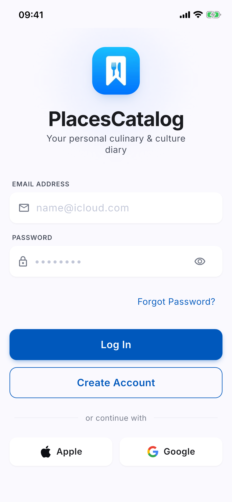
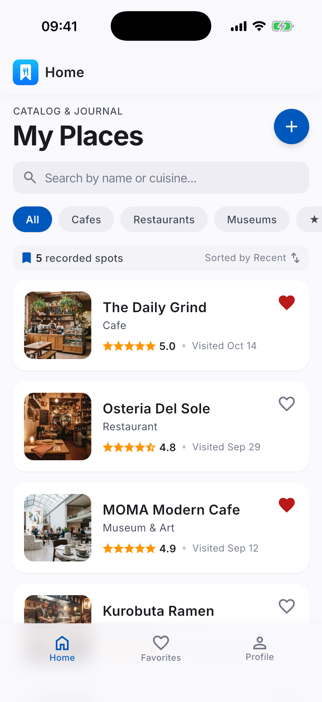
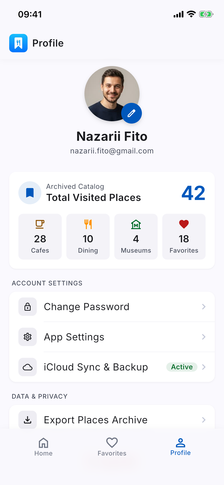

# PlacesCatalog

*Your personal culinary & culture diary* — мобільний застосунок для збереження відвіданих закладів (кафе, ресторани, музеї тощо) з оцінками, нотатками, тегами й фото.

Лабораторні роботи №3–4 з дисципліни «Кросплатформне програмування» (НУ «Львівська політехніка», гр. ПЗ-33, Фітьо Назарій): базова структура застосунку та pixel-perfect верстка основних екранів за дизайном із ЛР №2, **без бізнес-логіки** (hardcoded / mock-дані).

## Стек

- Flutter 3.47 (stable), Dart 3.13, null safety, Material 3 + Cupertino-віджети.
- Цільова платформа — iOS 14+ (дизайн за Apple HIG); Android підтримується архітектурою.
- Залежності: `cupertino_icons`, `flutter_svg` (SVG-іконки з Figma); з ЛР №4 — `firebase_core`, `firebase_auth`, `firebase_analytics`, `firebase_crashlytics`, `google_sign_in`.
- **ЛР №4:** Firebase Auth (email/пароль, Google, відновлення й зміна пароля, об'єднання способів входу), Analytics (події та екрани), Crashlytics. Уся робота з Auth — у `AuthRepository` (`lib/data/repositories/`); екрани SDK не імпортують.
- Без state-management бібліотек: стан через `StatefulWidget` + `setState`, сервіси через `InheritedWidget` (`AppScope`), навігація через `Navigator` з іменованими маршрутами та `CupertinoPageRoute`.
- Шрифт Inter 4.1 (OFL) вбудовано в `assets/fonts/`.

## Екрани

| Етап 1 | Етап 2 |
|---|---|
| Login, Create Account, Forgot Password (зі станом «Check your email») | Favorites |
| Home (пошук, фільтри, сортування, список закладів) | Place Details (редагування нотаток, теги) + підтвердження видалення |
| Profile (статистика, зміна пароля, експорт, вихід) | Add Place |
| Change Password, Edit Profile, Export Archive (JSON) | Location Picker |

Навігація між вкладками — нижній Tab Bar (Home / Favorites / Profile).

## Запуск

```sh
flutter pub get
flutter run                  # стартує з екрана входу
flutter analyze              # 0 issues
flutter test                 # widget-тести, перевірка overflow
```

Firebase-конфігурацію згенеровано `flutterfire configure` (проєкт `placescatalog-7730`); файли `firebase_options.dart`, `GoogleService-Info.plist`, `google-services.json` уже в репозиторії.

Скриншот-режим без мережі й справжнього акаунта (fake-репозиторій), з потрібним стартовим екраном і вкладкою:

```sh
flutter run --dart-define=FAKE_AUTH=signed_in --dart-define=INITIAL_ROUTE=/home --dart-define=INITIAL_TAB=2
```

## Структура

```
lib/
├── app/        # MaterialApp, маршрути (app_routes.dart)
├── core/       # дизайн-система: theme (токени з Figma), constants, widgets
├── data/       # незмінні моделі та mock-дані
└── features/   # екрани за фічами: auth, home, favorites, places, profile, shell
```

Повне дерево — `docs/report/structure.txt`.

## Документація

- `docs/decisions.md` — розбіжності в дизайні та ухвалені рішення.
- `docs/screenshots/`, `docs/compare/` — скриншоти з iOS-симулятора і порівняння з Figma.
- `docs/report/` — матеріали для звіту ЛР №3 (структура, рисунки, приклади коду, використання LLM, шпаргалка до захисту).
- `docs/report_lab4/` — матеріали для звіту ЛР №4 (код репозиторію, форми, `main.dart`, структура, скриншоти, список скриншотів консолі, шпаргалка).

## Скриншоти

| Login | Home | Profile |
|---|---|---|
|  |  |  |
